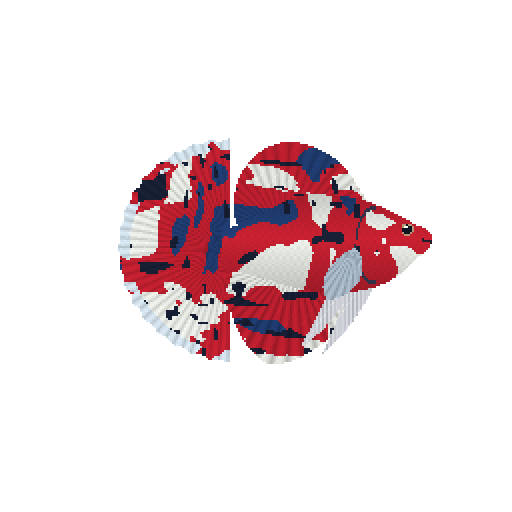
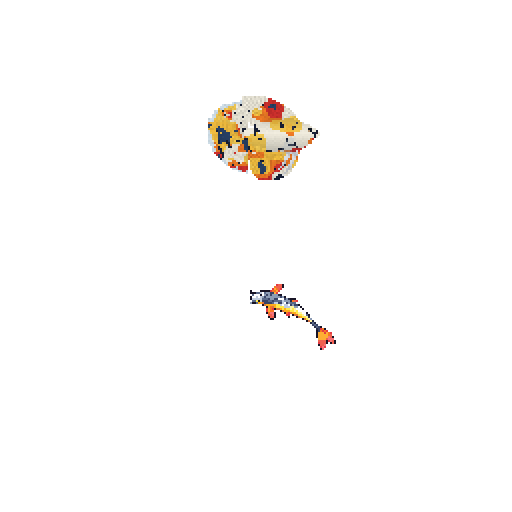

# LTKoi

Turn LeetCode progress into a male Halfmoon betta with koi marbling, or put it
beside a GitHub koi in a shared pond. Export a looping GIF for a profile README
and a self-contained website widget with hover, keyboard, and tap flaring.

| Mode    | Accounts          | Output                                     |
| ------- | ----------------- | ------------------------------------------ |
| `betta` | LeetCode          | A personalized Halfmoon betta              |
| `pond`  | LeetCode + GitHub | Betta and koi with independent development |
| `koi`   | GitHub            | The original GitHub activity koi           |



The example above uses synthetic data. The configured daily pond for this fork
uses **Hecker2026** on LeetCode and **Akshith-AI** on GitHub.

## Put a fish on your GitHub profile

1. Copy [examples/profile-workflow.yml](examples/profile-workflow.yml) into your
   profile repository as `.github/workflows/refresh-fish.yml`.
2. In that repository's **Settings → Secrets and variables → Actions →
   Variables**, add `LEETCODE_USERNAME` with your public LeetCode username.
3. Run **Refresh fish** from the Actions tab once.
4. Add this to your profile README:

   ```html
   
   ```

The workflow runs daily at **05:23 UTC** and commits the GIF only when it
changes. To use a betta alone, set repository variable `LTKOI_MODE` to `betta`
and embed `fish/betta.gif`. For GitHub only, choose `koi` and embed
`fish/koi.gif`—no LeetCode username is required. `LTKOI_GITHUB_USERNAME`
overrides the repository owner.

The Action itself never commits or deploys anything. Your workflow owns those
steps. Its built-in GitHub token is sufficient; no LeetCode session cookie or
password is required.

## Use the Action in an existing workflow

```yaml
- uses: Akshith-AI/git-koi@v0.1.0
  id: fish
  with:
    mode: pond
    leetcode-username: YOUR_LEETCODE_USERNAME
    github-username: YOUR_GITHUB_USERNAME
    output-dir: fish
```

The Action supports Linux and macOS GitHub-hosted runners and downloads the
matching release binary with checksum verification. Pin the full release tag
above, or pin a commit SHA. [All settings and outputs](docs/getting-started.md).

## Run locally

Download the archive for your platform from
[LTKoi releases](https://github.com/Akshith-AI/git-koi/releases), verify its
`.sha256` file, extract it, and put `ltkoi` on your PATH. Or build from source
with Rust 1.88 or newer:

```sh
cargo install --git https://github.com/Akshith-AI/git-koi --tag v0.1.0 --locked
```

Collect a public profile and generate the betta:

```sh
ltkoi collect-leetcode YOUR_LEETCODE_USERNAME --output leetcode.json
ltkoi animate-betta leetcode.json --output-dir fish
```

For a shared pond, install the [GitHub CLI](https://cli.github.com),
authenticate with `gh auth login`, then:

```sh
ltkoi collect YOUR_GITHUB_USERNAME --output github.json
ltkoi animate-pond github.json leetcode.json --output-dir fish
```

Collection needs curl for LeetCode and an authenticated GitHub CLI for GitHub.
Rendering saved snapshots needs no network. Stills remain available through
`render-betta`; GitHub-only koi rendering uses `render`.

## Embed on a website

Copy the complete generated `fish/` folder to your static site and embed
`/fish/embed.html` in an iframe. It includes swimming, independent fin movement,
hover/focus/tap flaring, a pause button, and reduced-motion support. A README
GIF cannot respond to hover.

[Website setup and examples](docs/animation.md) ·
[Fish traits and gallery](docs/betta.md) ·
[LeetCode data meanings and limits](docs/leetcode.md)

## Daily refresh settings

| Repository variable     | Default          | Meaning                                               |
| ----------------------- | ---------------- | ----------------------------------------------------- |
| `LEETCODE_USERNAME`     | Unset            | Public LeetCode username; required for betta/pond     |
| `LTKOI_MODE`            | `pond`           | `betta`, `pond`, or `koi`                             |
| `LTKOI_GITHUB_USERNAME` | Repository owner | Public GitHub account                                 |
| `LTKOI_PUBLISH_WIDGET`  | `false`          | Commit the full website bundle in addition to the GIF |

Every refresh attaches the complete output as a downloadable Actions artifact.
The profile example commits only the chosen GIF by default. Setting
`LTKOI_PUBLISH_WIDGET=true` also keeps the website assets in Git; hosting
remains under your website's control. Schedules can be delayed by GitHub and may
pause in inactive public repositories; a manual run is always available.

## Attribution and license

LTKoi adapts [git-koi](https://github.com/yalongwastaken/git-koi) by
[Anthony Yalong (@yalongwastaken)](https://github.com/yalongwastaken). The
original koi geometry, coat, movement, frame encoding, and supporting
history/collection pipeline originate from his MIT-licensed project. LTKoi adds
the LeetCode data source, original Halfmoon betta art, animation, shared pond,
and website controls.

The original copyright and permission notice are retained in [LICENSE](LICENSE).
See [NOTICE.md](NOTICE.md), [CHANGELOG.md](CHANGELOG.md), and the preserved
[upstream changelog](docs/upstream-changelog.md).

## Development

See [CONTRIBUTING.md](CONTRIBUTING.md) for checks and browser tests,
[docs/releasing.md](docs/releasing.md) for the release process, and
[docs/roadmap.md](docs/roadmap.md) for implementation stages.
