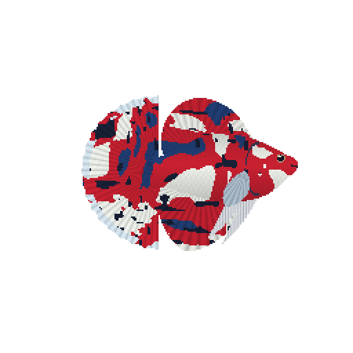
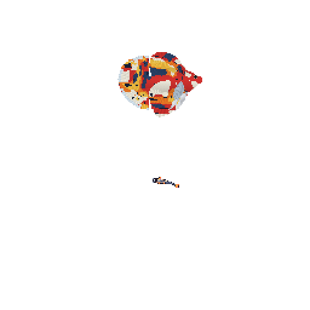

# Animation, shared pond, and website embeds

Stage 4 exports two modes from saved snapshots: a LeetCode betta alone or a
GitHub koi and LeetCode betta in one pond. Rendering is offline. The existing
portrait and original GitHub koi commands remain available.

## Generate the betta

Collect a LeetCode profile as described in the [data guide](leetcode.md), then:

```sh
cargo run --release --locked -- animate-betta target/leetcode.json --output-dir target/animated-betta
```

For an offline synthetic example, use the committed fixture:

```sh
cargo run --release --locked -- animate-betta tests/fixtures/leetcode/betta-snapshot.json --output-dir target/animated-betta
```



## Generate the shared pond

First collect a GitHub snapshot with the authenticated GitHub CLI and a LeetCode
snapshot; the two usernames can be different. Pass the GitHub snapshot first:

```sh
cargo run --release --locked -- collect YOUR_GITHUB_USERNAME --output target/github.json
cargo run --release --locked -- collect-leetcode YOUR_LEETCODE_USERNAME --output target/leetcode.json
cargo run --release --locked -- animate-pond target/github.json target/leetcode.json --output-dir target/animated-pond
```

The koi's growth, coat, and chosen behavior still come from its GitHub snapshot.
The betta's size, difficulty palette, and topic marbling come from LeetCode.
Each fish swims in its own lane, with opposite curved courses so the fish stay
readable without crossing or clipping. The betta turns to face its travel rather
than sliding backward. In betta-only mode it follows a wider oval course, with
foreshortened turns, gentle banking, and trailing tail and fin waves. The koi's
native loop is retimed to the shared four-second loop. It is not assigned the
betta's activity or growth.

This synthetic example has a juvenile GitHub koi because the inherited fixture
contains few contributions; a mature GitHub profile produces a larger koi:



## Output files

| File                                | Purpose                                                            |
| ----------------------------------- | ------------------------------------------------------------------ |
| `betta.gif` or `pond.gif`           | Portable 512-square, 60-frame, four-second looping GIF             |
| `betta.png` / `pond.png` and `.svg` | Fully spread still presentation pose                               |
| `sprites.png`                       | Full-color atlas: five flare states, each with 60 native frames    |
| `widget.js`                         | Local interaction and animation controller                         |
| `embed.html`                        | Standalone interactive website widget                              |
| `preview.html`                      | The same widget for previewing locally                             |
| `animation.json`                    | Mode, source observation dates, activity, frame rate, atlas layout |

GIFs use deterministic per-frame median-cut palettes with at most 255 opaque
colors plus transparency. This approximates colors for GIF export only; the PNG,
SVG, and website atlas keep full color. The original exact-color GitHub koi
encoder is unchanged. GIFs swim in a relaxed pose; hover flaring is a website
feature, not a GIF feature.

The marbling includes ivory, crimson, indigo, tangerine, and gold, with softer
fin shading. Difficulty influences the base color balance and topics shape
coherent patches; the warm accents do not invent extra activity metrics.

The sprite atlas is 2560 by 7680 pixels and can be several megabytes. It is
loaded once by the widget; interaction never calls LeetCode or GitHub. A bundle
is generated in memory before writes begin, and each output file uses a sibling
temporary replacement. The whole directory is not an atomic transaction if a
later filesystem write fails.

## Preview and embed on a website

Serve the complete generated folder over HTTP. For local testing:

```sh
python3 -m http.server 8000 --directory target/animated-betta
```

Open `http://localhost:8000/preview.html`. For deployment, copy every file from
the generated folder to your static website, for example under `/fish/`. Embed
it in a portfolio using an iframe:

```html
<iframe
  src="/fish/embed.html"
  title="My LeetCode Halfmoon betta"
  width="560"
  height="820"
  style="width: 100%; max-width: 560px; border: 0"
  loading="lazy"
></iframe>
```

The iframe supports multiple independently generated fish widgets on one page.
The bundle has no third-party scripts, tracking, API credentials, or runtime
backend. Keep relative asset paths intact. The JavaScript source must be allowed
by your site's content policy. Direct `file://` previews may use bounding-box
hover fallback when browser canvas security prevents pixel hit testing; HTTP
embeds use actual betta pixels. In pond mode the koi's lane does not trigger the
betta's flare.

- Hover the betta: open the fins, tail, and gill covers across five rendered
  states.
- Leave it: ease back to normal swimming.
- Focus the fish with Tab: flare; move focus away to relax.
- Tap on touch devices: flare briefly, then relax automatically.
- Pause swimming: stop the loop while retaining the ability to inspect a flare.
- Reduced-motion preference: stop swimming and apply flare changes immediately.
- Hidden tabs: stop scheduling animation; resume without a large frame jump.

The still-pose link and no-script text remain available when animation is not
supported. GIFs embedded in a README do not inherit the website's pause button
or reduced-motion handling; use the PNG if you want a motion-free README.

## Activity semantics

Recent accepted submissions within the snapshot's last seven UTC days, or
positive calendar activity in a complete seven-day calendar window, produce a
more energetic fin beat. A complete available calendar window with no activity
produces quiet swimming. Missing activity or an incomplete window across New
Year uses neutral swimming. An empty limited recent-accepts list alone does not
prove inactivity. Calendar attempts remain distinct from unique solved problems,
and endpoint streak values are not reinterpreted as current daily streaks.

## Verification

Verified November 25, 2026, on Apple Silicon macOS with Rust 1.88 and headless
Chrome:

- All 134 Rust tests passed in the release profile, including ten new motion and
  animation-export tests. Formatting, Clippy with warnings denied, release
  build, and API documentation with warnings denied passed.
- Rust tests cover loop closure, bounds at every flare level, activity fallback,
  atlas layout, escaped widget text, safe lane separation, command usage,
  complete output bundles, GIF frame counts and timing, and preserving existing
  output when an invalid snapshot is supplied.
- Browser tests exercise swimming, pixel hover, pointer leave, keyboard focus,
  pause/resume, reduced motion, and a brief touch flare that returns to idle.
- Both generated GIFs were decoded across all 60 frames and verified to loop
  indefinitely with a four-second duration. Both atlases decoded successfully.
- The generated betta and pond website previews were visually inspected.

To reproduce the browser tests after generating both synthetic bundles:

```sh
cargo build --release --locked
cargo run --release --locked -- animate-betta tests/fixtures/leetcode/betta-snapshot.json --output-dir target/animated-betta
cargo run --release --locked -- animate-pond tests/fixtures/account-with-history.json tests/fixtures/leetcode/betta-snapshot.json --output-dir target/animated-pond
npm ci
npx playwright install chromium
npm run test:widget
```

For an installed browser, set `LTKOI_BROWSER` to its executable path instead of
installing Chromium. The CI widget job generates both bundles from fixtures and
runs these browser checks without account access.

Stage 5 remains: fork-specific release packaging, the daily refresh workflow,
installation examples, and publishing. This stage does not publish or host a
site.
