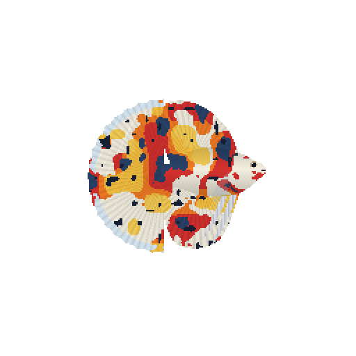
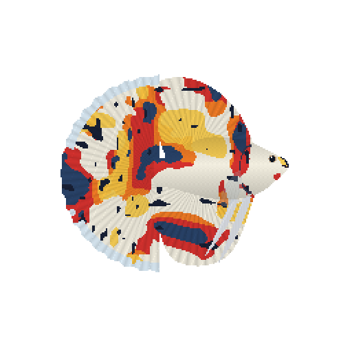
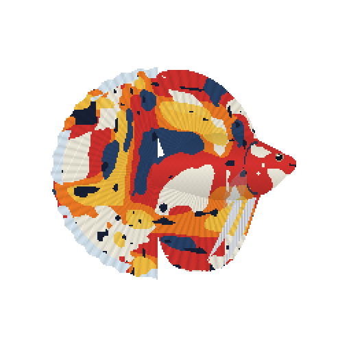
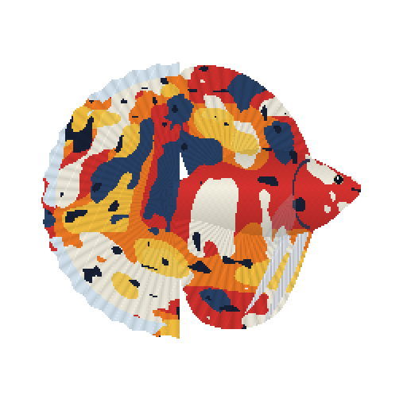

# Halfmoon betta portraits

Stage 3 draws an original male Halfmoon betta with koi marbling from a saved
LeetCode snapshot. It is a side-view pixel-art portrait with a spread 180-degree
caudal fan, a compact body, flowing dorsal and anal fins, paired slender ventral
fins, a foreground pectoral fin, and a visible eye, mouth, and gill-cover arc.

The geometry and marble patterns are generated in Rust, not copied from the
reference photograph. The existing git-koi frame and PNG/SVG encoders are reused
with attribution; the GitHub koi's geometry and behavior remain unchanged.

## Generate your fish

First collect a profile, then draw it. Requires Rust 1.88 or newer; collection
also requires curl. Rendering a saved profile needs no network or login.

```sh
cargo run --release --locked -- collect-leetcode YOUR_LEETCODE_USERNAME --output target/leetcode.json
cargo run --release --locked -- render-betta target/leetcode.json --output-dir target/my-betta
```

Open `target/my-betta/preview.html` for light and dark background previews, the
metric legend, and links to the SVG portrait and trait data. Outputs are:

- `betta.png`: 512 by 512 transparent PNG, rendered at 256 native pixels and
  doubled without interpolation.
- `betta.svg`: a self-contained SVG of those same pixels.
- `traits.json`: the identity seed, solve total, growth, difficulty shares, and
  normalized topic weights that produced the drawing.
- `preview.html`: a local still-image preview without scripts or remote assets.

The snapshot schema, username, difficulty totals, and available topic counts are
validated before rendering. Unsupported versions and inconsistent counts fail
without replacing the existing portrait. PNG encoding happens before output
writes; each file is replaced through a temporary sibling file. The four output
files are not a single filesystem transaction if a write fails halfway through.

## Visual legend

| Trait         | Appearance                                           |
| ------------- | ---------------------------------------------------- |
| Username      | Stable placement of marble patches, case-insensitive |
| Unique solves | Logarithmic size growth, capped at 3,000 solves      |
| Easy share    | More ivory pigment, with gold accents                |
| Medium share  | More crimson pigment, with tangerine accents         |
| Hard share    | More indigo pigment                                  |
| Topic mix     | Smooth directional warping of marble patch shapes    |
| No topic data | Identity-based marbling remains available            |

Ivory, crimson, and indigo keep a baseline presence so the fish stays
recognizably koi marbled, with coherent gold and tangerine patches adding
warmth. Difficulty shares influence the palette; they are not exact measured
pixel-area percentages. A confirmed zero-solve account has a neutral starter
palette. Every growth stage retains Halfmoon fins; the minimum linear scale is
64% of the mature portrait. Growth never rerolls the username's identity seed.

Topic weights use overlapping tag incidences, as explained in the
[collection guide](leetcode.md). Topics influence the pattern continuously;
there is no fixed claim that a particular spot means a particular problem.
Unavailable calendars, recent accepts, and endpoint streak values do not change
this still portrait. They must not be treated as evidence of inactivity.

## Synthetic examples

These examples use the same username to show progression and topic influence.
They are illustrations from synthetic profiles, not anyone's live account.

| New account: 0 solves                              | Arrays / Strings: 300 solves                  |
| -------------------------------------------------- | --------------------------------------------- |
|  |  |

| Graphs / DP: 709 solves                                      | Trees / DP: 3,000 solves                                        |
| ------------------------------------------------------------ | --------------------------------------------------------------- |
|  |  |

Reproduce the four images and their synthetic snapshot files:

```sh
cargo run --release --locked --example betta-gallery -- target/betta-gallery
```

## Reference anatomy check

The user-provided koi-marble photograph was compared directly against the
rendered portrait on November 25, 2026. The drawing remains an original
pixel-art interpretation. Red, ivory and blue come from the reference palette;
gold and orange were added at the user's subsequent request. The marbling is
personalized from profile data, not a copy of the photograph's patch layout.

The reference review corrected the previously pointed anal fin to a broader,
round-cornered outline, narrowed the paired ventral filaments, reduced the
pectoral fin, and simulated its thin membrane by blending its color with the
underlying pattern. The dorsal outline now flows more naturally toward the
caudal fan. Binary output alpha is retained for GIF compatibility; the pectoral
translucency is a color treatment rather than partial output transparency.

The intended single-tail Halfmoon form is checked against the
[International Betta Congress longfin Halfmoon standard](https://www.ibcbettas.org/wp-content/uploads/2025/06/IBC-2022-Exhibition-Standards-Book-01-Final.pdf):
a spread semicircular tail and a broad anal outline, with balanced fins. The
standard guides silhouette and fin placement; the sprite uses simplified
pixel-art anatomy. The source photograph remains outside the repository.

## Validation and remaining work

Verified on November 25, 2026, with Rust 1.88.0 on Apple Silicon macOS:

- All 124 tests passed in the release profile, including nine new betta tests.
- The nine betta tests also passed in the development profile.
- Rust formatting, Clippy with warnings denied, the locked release build, and
  API documentation with warnings denied passed.
- Tests cover stable identity, growth limits, malformed snapshots, topic-order
  invariance, palette changes, transparent margins at all sizes, escaped preview
  text, CLI exports, and preserving an existing portrait on invalid input.
- Beginner, Arrays, Graphs/DP, and expert drawings were visually inspected.

This command remains a still-image renderer. Stage 4 adds separate animation
commands, the shared pond, and website hover/focus/tap flaring; see the
[animation guide](animation.md). Release packaging and an automatically
refreshed published Action remain stage 5.
